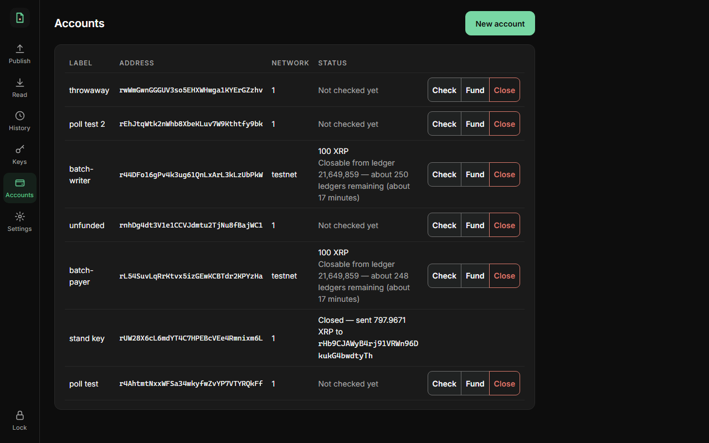
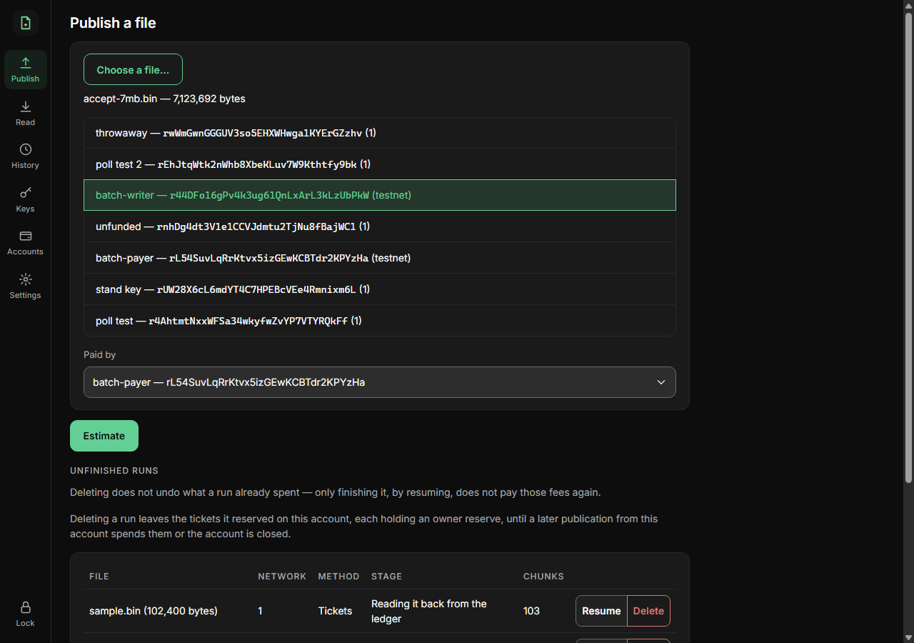
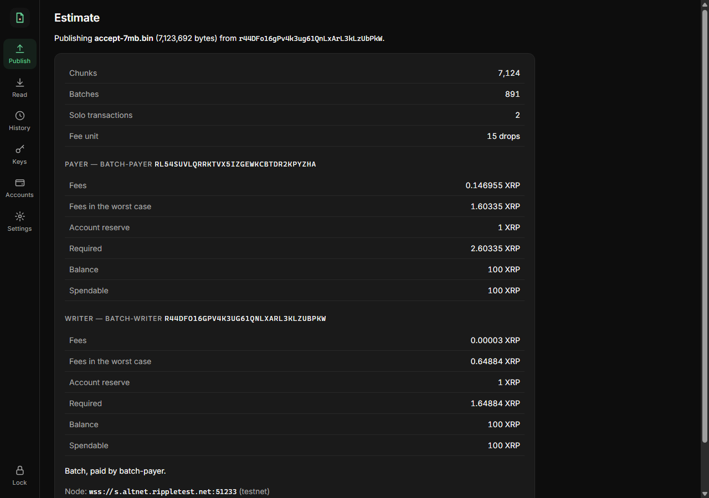
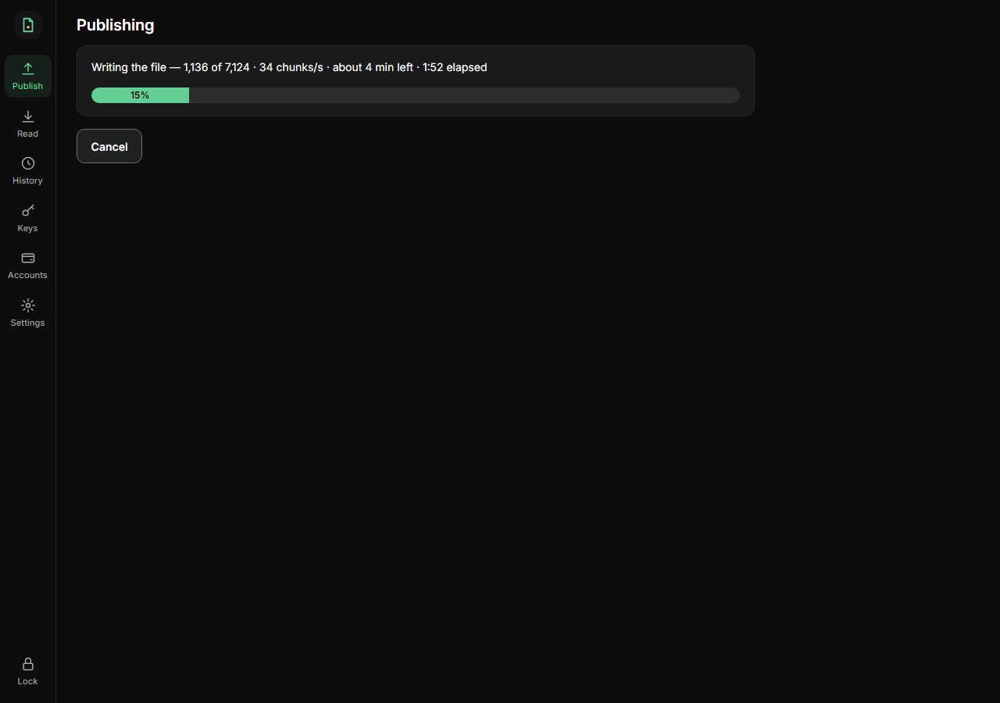
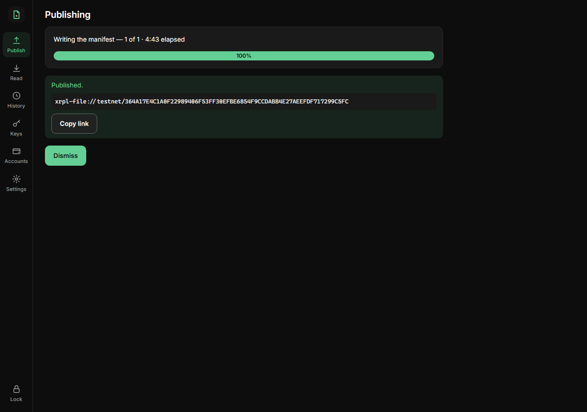
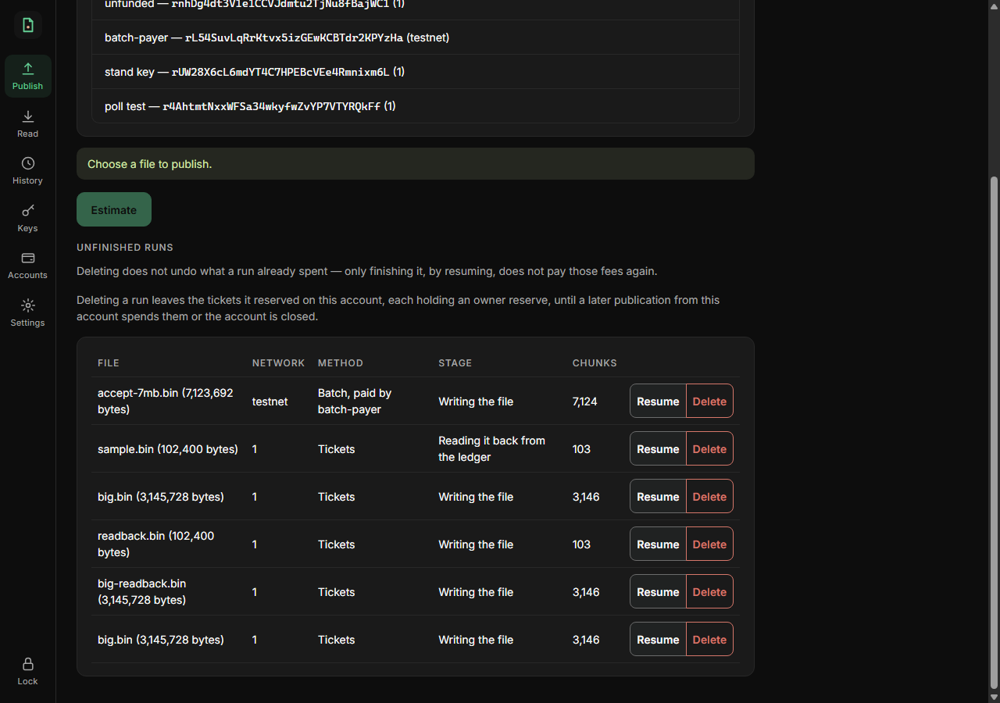
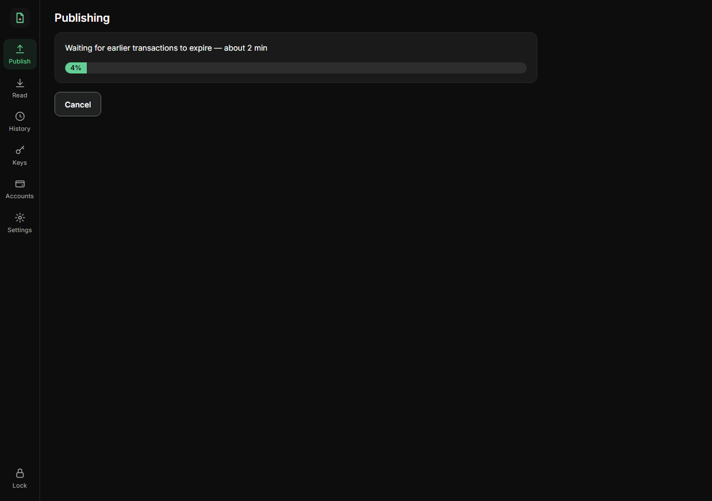
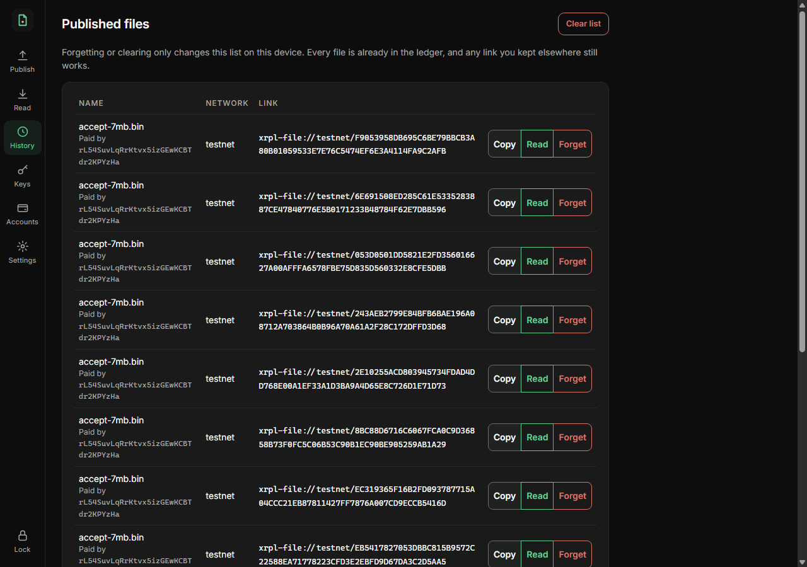
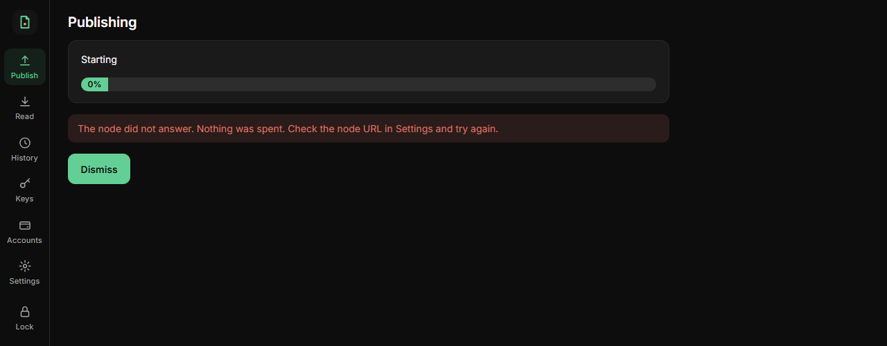

# Batch publishing acceptance on testnet

Plan task 24 (spec section 7.6). The desktop application ran in the MauiLab VM, against testnet, on 2026-10-19.

## Setup

| Item | Value |
|---|---|
| Application commit | `5294cce` (branch `claude/batch-publishing-fd956b`), deployed from the branch's worktree |
| Node | testnet, `wss://s.altnet.rippletest.net:51233` |
| Writer | `batch-writer`, `r44DFo16gPv4k3ug61QnLxArL3kLzUbPkW` |
| Payer | `batch-payer`, `rL54SuvLqRrKtvx5izGEwKCBTdr2KPYzHa` |
| File | `accept-7mb.bin`, 7,123,692 random bytes, SHA-256 `CFBD6F9FFCDB3DBF721F51D6CCE0CF05D6047FBB08059301958E47BC16E3AFD0` |

The lab vault held no testnet keys, so both keys were created in the application for this run. Each was funded with 100 XRP from the testnet faucet over HTTP, because the Funding screen has no faucet button. The 7,123,692-byte file of the 2026-10-13 ticket run was no longer on the host, so a new random file of the same size was used.

## Estimate

"Paid by" offered the payer key, the only other testnet key in the vault, and selected it.

| Figure | Payer | Writer |
|---|---|---|
| Fees | 0.146955 XRP | 0.00003 XRP |
| Fees in the worst case | 1.60335 XRP | 0.64884 XRP |

The file is 7,124 chunks, sent as 891 batches and 2 solo transactions at a fee unit of 15 drops. The method line read "Batch, paid by batch-payer."

## Publication and wall time

| Run | Wall time | Rate |
|---|---|---|
| First Batch publication | 266.3 s (4:26) | 26.8 chunks/s |
| Later publications of the same file | 2:47, 1:55, 2:16 | writing stage about 75 s |
| 2026-10-13 ticket run, for comparison | 530 of 7,124 chunks in about 7 min, then stopped | about 1.3 chunks/s |

The first run stalled at 1,136 of 7,124 chunks for about 95 s and then finished.

- Link: `xrpl-file://testnet/364A17E4C1A0F22989406F53FF30EFBE6854F9CCDABB4E27AEEFDF717299C5FC`

## Read-back

| Reader | Bytes | SHA-256 | Time |
|---|---|---|---|
| Application, Read tab (file saved and hashed in the guest) | 7,123,692 | matches | about 50 s |
| Web reader (`web/xrpl-file.js` under Node, on the host) | 7,123,692 | matches | 93 s |

The web reader also read back four of the resumed publications' links. Each returned the same 7,123,692 bytes with the same SHA-256.

## Interrupt and resume

Five runs were interrupted.

### Closing the window

Each run was interrupted during "Writing the file". The close prompt ("Publication in progress … Close anyway?") appeared and was confirmed. After the restart, the row in Publish > Unfinished runs read "Batch, paid by batch-payer".

Resume opened no file dialog, and every resumed publication read back with the same bytes.

The fence wait was not seen after a close and restart. Restarting and unlocking took 100 s or more in this VM because WebView2 started slowly. The fence was about 80 s, so it had already expired when Resume was pressed. Those resumes showed "Starting" for 25–36 s and then began writing.

### Cancelling in place

One run was cancelled and then resumed 1.1 s later in the same process.

- Immediately: "Waiting for earlier transactions to expire — about 2 min".
- At +24 s: "about 56 s".
- From about +89 s: writing.

The resumed publication read back with the same bytes.

History lists all nine publications of `accept-7mb.bin`, one record for each run that finished, each with "Paid by rL54Su…".

## Spend, from account balances

| Account | Before | After 9 publications | Spent | Per publication |
|---|---|---|---|---|
| Payer | 100 XRP | 98.677405 XRP | 1,322,595 drops | 146,955 drops, exactly the estimate |
| Writer | 100 XRP | 99.999730 XRP | 270 drops | 30 drops |

An interrupted and resumed run cost the same as an uninterrupted one: the payer paid 138,105 drops before the interrupt and 8,850 after it, 146,955 in total. Both accounts end with OwnerCount 0.

## Connection

`ClientKeeper` owns reconnection, with the SDK's own reconnection turned off. It held across nine publications of 4–6 min each and four reads against the remote TLS node, with no drop during a run. The only connection failure is defect 1.

## Defects

None of these is fixed in this task. Each is a follow-up.

1. **"The node did not answer. Nothing was spent." while the node was reachable (high).** The first Estimate > Publish of the second publication in a session did not start a run for about 5 min. The next press produced the error. A third press, about 3 min later and with nothing else changed, worked. A wait of 5 min matches the SDK's `ConnectionAcquisitionTimeout` in `Xrpl` 11.2.0, so a fresh connection after a finished run may be what hangs. This is unconfirmed. 
2. **The run line keeps counting after "Published." (low).** The elapsed counter keeps running: 4:43 shown for a run that finished at 4:26 (06), and 5:03 for one published at 2:54 (10). The last stage text also stays next to "Published.".
3. **The run line keeps counting after Cancel (low).** Under "Cancelled. Nothing further was submitted.", the elapsed time keeps ticking and the rate comes back. This was seen in the page text only, with no screenshot.
4. **The estimate upper-cases the addresses (medium).** CSS renders the payer and writer addresses in upper case (03). XRPL addresses are case-sensitive, so the displayed text is not a valid address.
5. **The early rate and time left mislead (low).** At 112 chunks the line read "3 chunks/s · about 35 min left", and the run finished about 190 s later. This was seen in the page text only.
6. **The fence wait overstates the time (low).** The wait read "about 2 min" at its start, and it ended after about 80 s (09). The conversion uses the approximate ledger interval, and testnet closes ledgers faster than that.

## Observations

- "Paid by" was filled in automatically with the only other testnet key.
- History shows the payer's address, not its label.
- Lab note: the native close prompt ignored Enter and injected mouse clicks. UI Automation's Invoke pattern worked.
