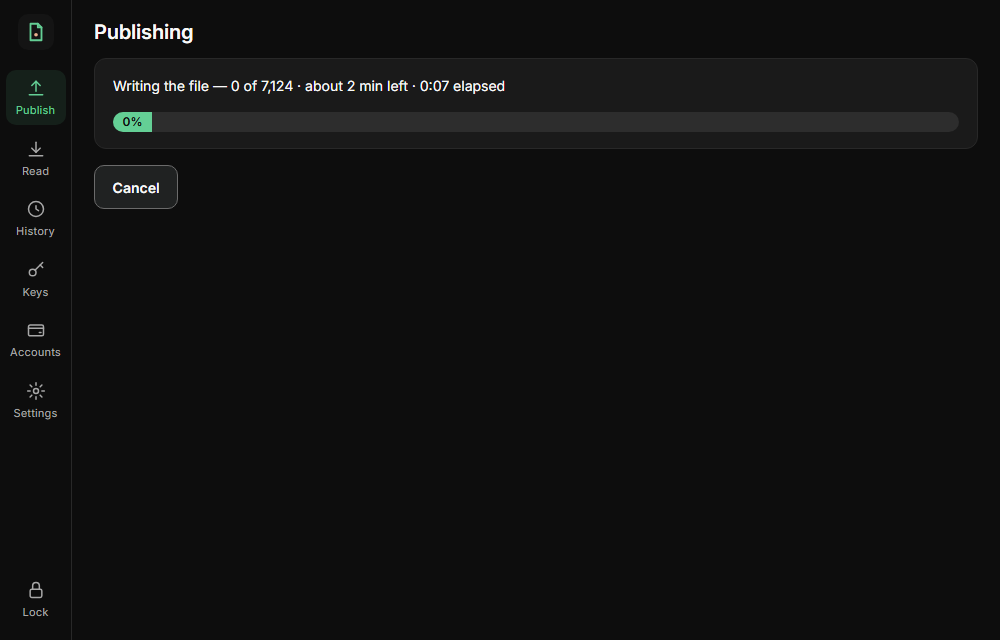

# Reading each history record once, and an honest "Starting"

Two follow-ups of the throughput report (`../2026-10-21-batch-throughput/report.md`, "What
remains", items 1 and 4), run on 2026-10-21 and 2026-10-22 against testnet
(`wss://s.altnet.rippletest.net:51233`).

## 1. The reader takes each history record from the node once

### What it did

A block's chunks are read forward from the block's own first ledger, the `l` of its block-list
entry. A block usually starts in the ledger the block before it ended in: on testnet a Batch ledger
holds about 2,048 chunks, two blocks. Each block walked the writer's history afresh, so the shared
ledger was read twice, and with it whatever the earlier block had already passed.

### The change

`ForwardHistory` (`src/XrplFile.Core/ForwardHistory.cs`, mirrored rule for rule in
`web/src/history.mjs`) is one read's forward walks. A walk that stops keeps its place and what it
read. The next walk replays the held records from its own first ledger and then carries the stopped
walk on. A walk starting one ledger past the stopped one's last record carries it on too, skipping
the rest of that ledger.

- What a walk yields is exactly what a fresh `account_tx` walk from its first ledger would yield,
  in the same canonical order. The chunk rule, the length rule, each block's hash and the list's
  root are checked exactly as before. Validated ledgers do not change between two walks of one read.
- Memory: at most 4,096 records (four blocks, two testnet Batch ledgers, about 17 MB of memo hex at
  the most), let go by whole ledgers; a walk further on drops everything before its first ledger.
- Another writer, another last ledger or another cancellation token starts over with a fresh walk.
  A walk that fails, including a source that refuses the walk as it is asked for, forgets
  everything, so the writer's read-back retry (`fd2ae2b`) asks the node again.
- A walk started while another is in progress goes to the node directly: blocks read at the same
  time stay correct, unshared.
- A range that ends before it starts goes to the node, which refuses it as it always did.

`XrplFileReader` holds one per instance, so the writer's read-back, `ReadAsync` and the Read
screen's block-by-block loop all share it within one read. The format document (section 6) states
that a reader may do this.

### Measured

A host harness (kept out of the repository) read two published 7,123,692-byte files with
`XrplFileReader` over `XrplClientLedgerSource` and counted the `account_tx` walks and the records
the reader pulled from them. Three reads of each, before (`7a1b5d2`) and after (`4e54fff`):

| File | | Block walks | Records | Blocks read | Whole read |
|---|---|---|---|---|---|
| `…9EADA766` | before | 7 | 9,564 | 21.5–21.8 s | 22.1–23.4 s |
| | after | 1 | 7,124 | 15.0–15.2 s | 15.7–16.7 s |
| `…91CE4CD8` | before | 7 | 9,748 | 21.9–22.1 s | 22.5–22.7 s |
| | after | 4 | 7,124 | 15.7–15.9 s | 16.3–16.5 s |

Both files hold 7,124 chunks; every read returned the same SHA-256. The block-list walk is one call
and one record in every run. `…91CE4CD8` keeps four walks because three of its blocks start two or
more ledgers after the previous block ended (the `MaxAhead` pauses leave ledgers with no chunks), so
the stopped walk is not carried on; each record is still pulled once.

The 12,300 records of the throughput report counted whole `account_tx` pages, this count the records
the reader consumed; the two are not the same measure. Time is dominated by page round trips (about
0.7 s per 400-record page on the public node), so it falls with the records: about 6.5 s, 28%.

## 2. "Starting" while the chunks are going out

The first progress sweep finds landed memos 5 s or more into sending, and the writer reported
nothing before that, so the run screen said "Starting" while batches were being signed and sent.

- `BatchProgress.Sent()`: the first answered transmission of a `SubmitAllAsync` call reports the
  count found so far, once, usually zero (spec B20 amended). The writer turns it into
  `PublishProgress("chunks", carried, total)`, and the screen shows "Writing the file — 0 of 7,124
  · about 2 min left · 0:06 elapsed". The rate is still measured from the first memo that landed.
- `RunModel`: before any report the line is "Starting · 0:07 elapsed", so a run that is connecting
  or checking its accounts shows that it is moving.

### In the application

The Release build of `16cba2f` ran in the MauiLab VM with the vault's `batch-writer` and
`batch-payer` keys and published the 7,123,692-byte `accept-7mb.bin` on testnet. A host loop read
the run line over CDP about once a second:

| Elapsed | Run line |
|---|---|
| 0:01–0:05 | Starting · 0:05 elapsed |
| 0:05 | Writing the file — 0 of 7,124 · about 2 min left |
| 0:11 | Writing the file — 24 of 7,124 (first sweep that found memos) |
| 2:44 | Writing the block list — 0 of 1 · about 13 s left |
| 2:50–3:03 | Reading it back from the ledger — 1 of 7 … 7 of 7 |
| 3:12 | Finished in 3:12 |

"Starting" lasted 5 s. In the five runs of the throughput report it lasted 10.7–20.8 s. The block
list pass now names itself as soon as its batch is answered, too. The link
`xrpl-file://testnet/F276C1C6FBEE5CE1C86572FDEED9228F25514A3F9A5DCFD7F38E21EFEBE341CA` read back
on the host with the right size and SHA-256 in 17.0 s (one block walk, 7,124 records).

The run took 3:12 against 93 s in the throughput report, because the chunks stood at 1,064 from
0:47 to 2:15. The 95 s stall of the first acceptance run looked the same. The application writes no
round trace, so its cause was not established here; nothing in this change touches the rounds other
than one progress report per call. During the stall the line showed "1.1 chunks/s · about 1 h 35
min left" for about 30 s before it fell back to "estimating…".

A first attempt in the VM did not select the payer and so published on the ticket path. It was
cancelled at 200 of 7,124. Its unfinished run, and the tickets it reserved on `batch-writer`, are
still in the guest.

Started by the VM's own launch script, which runs it elevated, the application's WebView2 opened no
CDP port, with or without the debug arguments. Started by the guest's non-elevated scheduled task
`XrplPlain`, it did.

## Follow-ups

- The stall at 1,064 chunks: a round trace in the application, or the host harness on the same
  accounts, would show whether a round halted and why.
- The rate during a stall: 30 s at "about 1 h 35 min left" before "estimating…".

## Tests

Unit: Core 677, App.Core 678, Keys 251, web 85. On the stand (`xrpl-file-ci`, started from the main
checkout): Core integration 44 of 44, App.Core integration 1 of 1. The application builds in
Release with 0 warnings.

The new tests were written first and failed on the old code: the reader takes each record once for
blocks sharing a ledger, also when the next block's chunks come first in that ledger; a walk that
fails mid-way is taken again from the block's own ledger; a Batch pass reports 0 once its first
batch is answered and not before; the "Starting" line carries the elapsed time.
